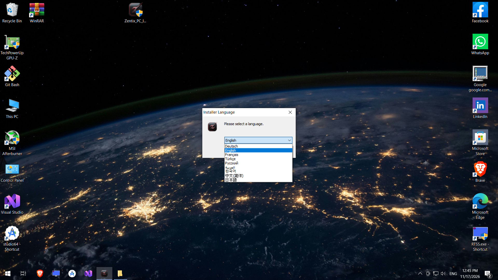
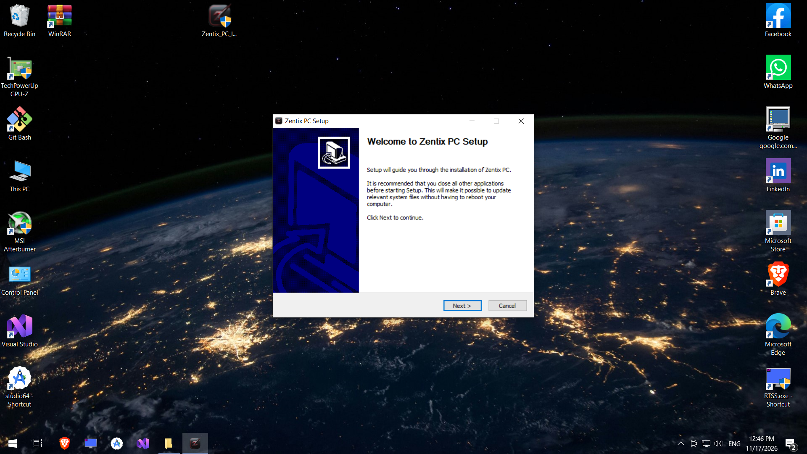
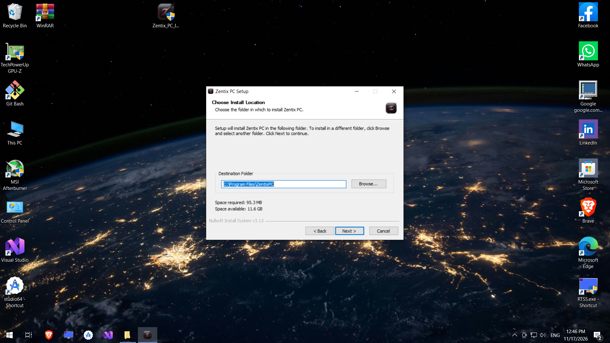
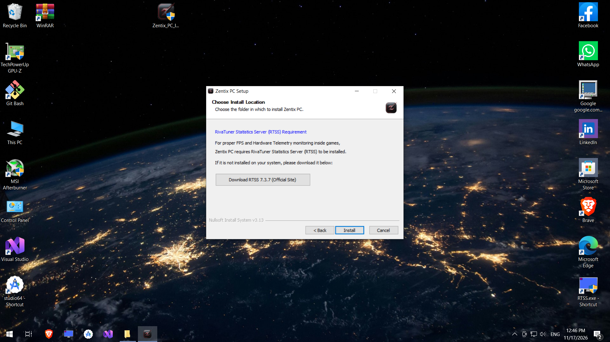
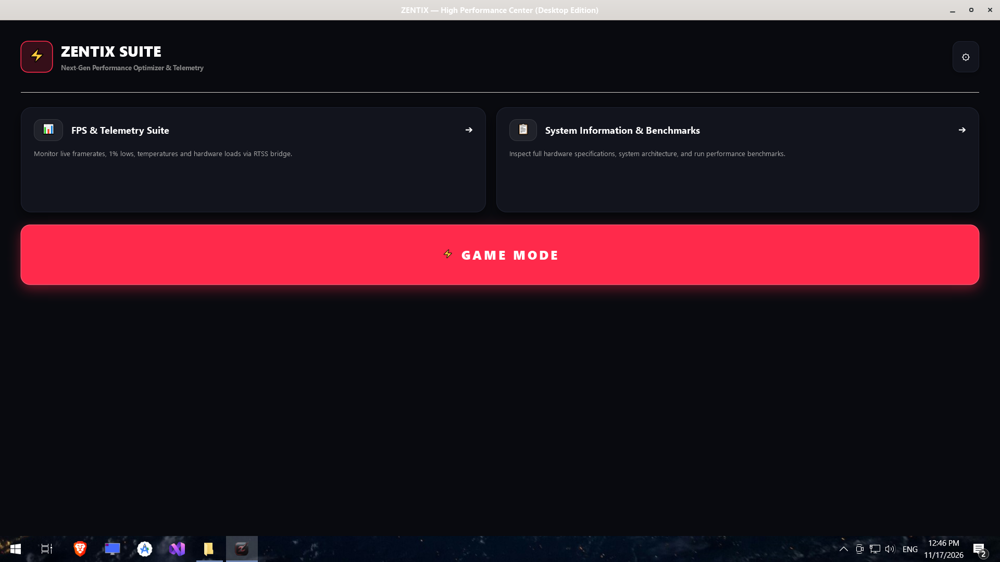
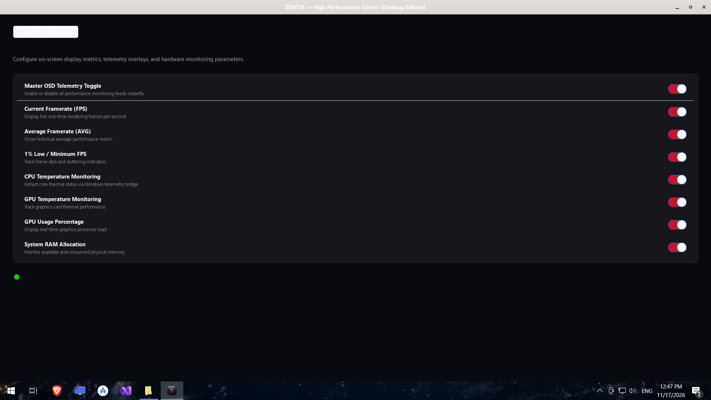
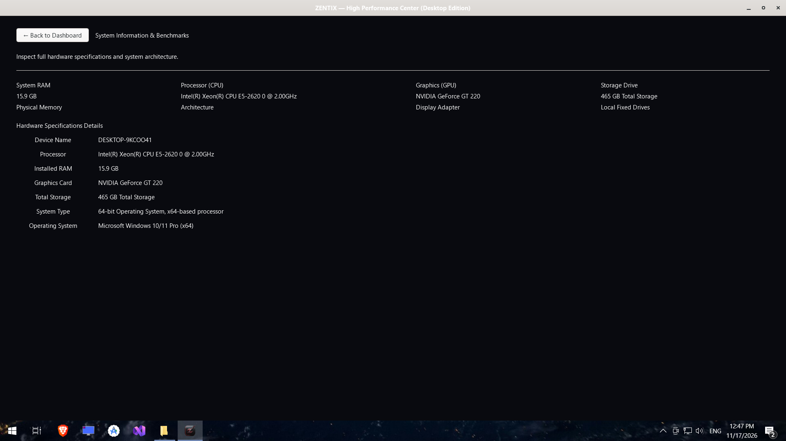
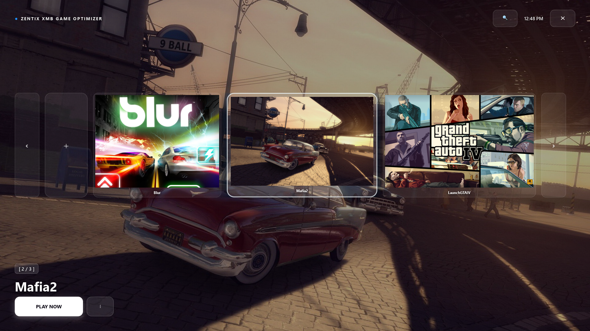
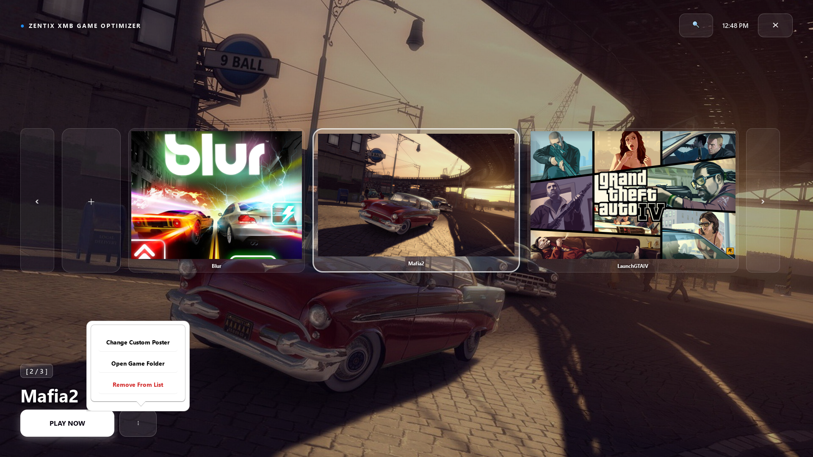
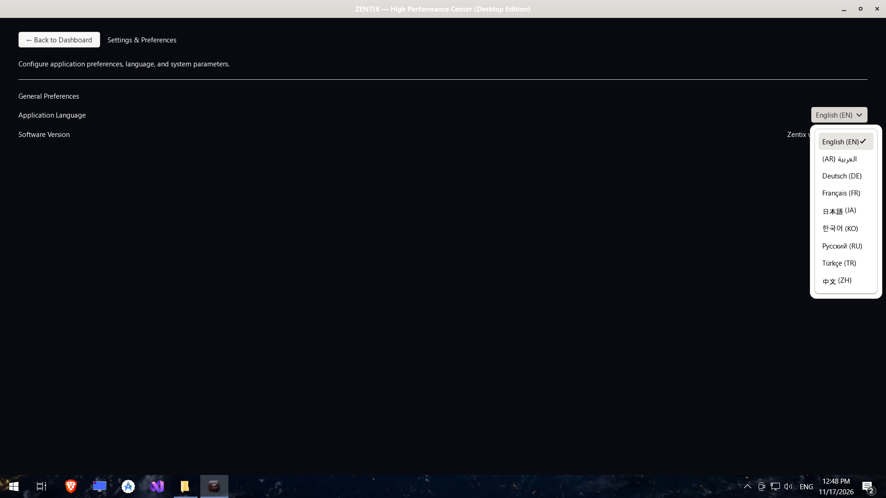

# 🚀 ZENTIX PC (XMB Game Optimizer & Telemetry Suite)

> An open-source, ultra-lightweight Windows PC gaming utility and hardware telemetry suite built from scratch in pure C and GTK 4, featuring an immersive PlayStation 3 XMB-inspired interface, real-time hardware monitoring, and multi-language support.

---

## 🌟 What Makes Zentix PC Unique? 

Unlike traditional, resource-heavy monitoring software, **Zentix PC** bridges the gap between raw hardware telemetry and a cinematic console-like user experience. It combines several powerful pillars into a single lightweight binary:
* **PlayStation 3 XMB Cinematic Interface:** A fully custom horizontal carousel layout (`HomeScreen`) that meticulously mimics the iconic PS3 aesthetic. It comes alive with original system audio (`ps3_click.mp3`, `ps3_startup.mp3`) and dynamic game banner management.
* **All-in-One Powerhouse:** Merges real-time FPS & hardware telemetry tracking, a dedicated game performance optimizer (`GameMod`), an in-depth system information dashboard (`SystemInfoScreen`), and a streamlined first-time onboarding wizard (`SetupWizard`).
* **Multi-Language Architecture:** Native, strict-indexed support for **9 different languages**, built from the ground up with proper `UTF-8 with BOM` encoding to guarantee flawless international text rendering and layout alignment.
* **Zero Bloat & High Performance:** Written entirely in pure C using GTK 4, eliminating the massive memory footprints typical of Electron or .NET-heavy utility software.

---

## 📸 Complete Showcase Gallery 

  
  

  
  

  
  

  
  

  
  

---

## 🛠️ Tech Stack & Low-Level Architecture 

* **Core Language:** Pure C (modularly structured into clean Data, Logic, UI, and Storage layers).
* **UI Framework:** GTK 4 with custom CSS styling and GStreamer media pipeline integration.
* **Hardware Telemetry APIs:**
  * **WinRing0:** Low-level kernel driver interface for direct hardware sensor access and ring-0 execution.
  * **NVIDIA NVAPI:** Direct GPU core clock, voltage, temperature, and usage telemetry.
  * **AMD ADL SDK:** Advanced Radeon performance metrics integration.
  * **Intel IGCL:** Integrated graphics monitoring and telemetry.
  * **RTSS & MSI Afterburner:** Real-time OSD (On-Screen Display) synchronization and shared memory readers.
* **Deployment & Setup:** Custom NSIS (Modern UI 2) installer script featuring custom `nsDialogs` for dependency checks, architecture validation, and robust registry configuration.

---

## 🔍 Deep-Dive: Engineering Challenges & Solved Problems 

The development of Zentix PC involved tackling several low-level roadblocks and systems-engineering challenges:

1. **GStreamer DLL Initialization & Dependency Paths:**
   * *Problem:* On standard Windows environments, bundling GStreamer media pipelines caused runtime crashes due to missing DLL search paths and relative directory misalignments.
   * *Solution:* Restructured asset loading logic and implemented explicit relative path resolution routines, ensuring media pipelines initialize cleanly on any clean Windows installation.

2. **Memory Leaks in Continuous Hardware Polling Threads:**
   * *Problem:* Continuous multi-threaded polling of CPU/GPU sensors led to gradual memory accumulation and resource leaks over prolonged runtimes.
   * *Solution:* Implemented strict thread synchronization protocols, efficient memory buffer reuse, and graceful resource cleanup loops during sensor polling cycles.

3. **NSIS UTF-8 Text Encoding & Multi-Language Mojibake:**
   * *Problem:* Multi-language installers suffered from character corruption (mojibake) and text rendering failures when handling non-English character sets (such as Arabic and European scripts).
   * *Solution:* Enforced strict `UTF-8 with BOM` file encodings and integrated `Unicode true` compilation directives inside the NSIS script to guarantee pristine multi-language rendering.

4. **RTSS / Afterburner IPC & Missing Process Graceful Fallbacks:**
   * *Problem:* If RivaTuner Statistics Server (RTSS) or MSI Afterburner was closed or not installed, traditional OSD tools would freeze or crash during startup telemetry handshakes.
   * *Solution:* Developed robust error-handling wrappers and fallback states that detect missing shared memory or inactive RTSS processes, allowing Zentix PC to run smoothly without crashing.

5. **Repository History Optimization & Build Hygiene:**
   * *Problem:* Managing multiple heavy build artifacts and messy commit histories cluttered the open-source presentation.
   * *Solution:* Streamlined commit structures via strategic rebasing, established clean `.gitignore` rules, and packaged a lightweight 3MB `.zip` deployment archive.

---

## 📦 Download & Installation

You can download the official lightweight installer package [realese]

Run the installer on Windows 10/11, follow the setup wizard steps, and enjoy an optimized gaming experience!

---

## 📬 Contact & Support 

If you have any questions, feedback, or collaboration proposals, feel free to reach out:
* **📧 Email:** [yahyaemad887@gmail.com](mailto:yahyaemad887@gmail.com)
* **💬 WhatsApp:** [+201553427179](https://wa.me/201553427179)s